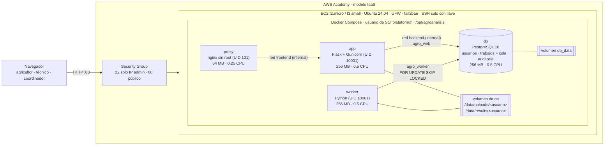

# AgroAnálisis Sugamuxi · Plataforma segura de procesamiento de archivos

Proyecto final de Sistemas Operativos - UPTC Sogamoso, 2026 · Docente: Mgtr. Fredy Alarcón

**Integrantes:** Didier Cristancho · Derick Rios · Juan Salamanca · Felix Siachoque

AgroAnálisis Sugamuxi es un **laboratorio ficticio de análisis de suelos**. Los agricultores envían resultados de laboratorio (`.csv`) e informes de campo (`.txt`). Un trabajador en segundo plano los procesa (estadísticas por columna, clasificación de pH, conteo de palabras y huella SHA-256), y cada agricultor descarga **solo sus** resultados. Los técnicos supervisan la cola y el coordinador administra usuarios, auditoría y reglas.

| Documento | Para qué |
|---|---|
| [GUIA_RETOS_SUSTENTACION.md](GUIA_RETOS_SUSTENTACION.md) | Los 6 retos sorpresa paso a paso, el cambio de regla de negocio de último minuto, el kit de emergencia y el guion de la demo |
| [docs/documento_tecnico.md](docs/documento_tecnico.md) | Base del documento técnico en PDF (contexto, arquitectura, decisiones, pruebas y limitaciones) |
| [docs/plan_verificado.md](docs/plan_verificado.md) | Plan inicial del proyecto corregido para que coincida con el código real |
| [GUIA_EQUIPO.md](GUIA_EQUIPO.md) | Cómo levantar todo en el computador de cada integrante |
| [datos_prueba/README.md](datos_prueba/README.md) | Carga de prueba propia y resultado esperado de cada archivo |

---

## 1. Arquitectura



**Flujo de un archivo:**
1. El agricultor lo sube. La app valida tipo, tamaño, UTF-8 y las reglas de negocio, guarda el archivo con nombre UUID en su carpeta, registra su SHA-256 y crea el trabajo `pendiente`. Responde de inmediato.
2. El worker toma el trabajo con `FOR UPDATE SKIP LOCKED` y verifica que el SHA-256 siga igual. Lo procesa en un proceso hijo con tiempo máximo y escribe el JSON de resultado.
3. El trabajo pasa a `completado` (con el hash del resultado) o a `fallido` (con el motivo).

Cada paso queda en la auditoría encadenada.

| Contenedor | Función | Puerto publicado | Usuario | Redes |
|---|---|---|---|---|
| `proxy` | Única entrada; cabeceras de seguridad, CSP y límite de intentos de login | **80 → 8080** | nginx (101) | edge, frontend |
| `app` | Web/API: sesiones, roles, subida, descarga, auditoría y panel de recursos | ninguno | app (10001) | frontend, backend |
| `worker` | Procesa la cola: pendiente → en_ejecucion → completado/fallido | ninguno | app (10001) | backend |
| `db` | PostgreSQL: usuarios, trabajos (la cola) y auditoría | **ninguno** | postgres (70) | backend |

Las redes `frontend` y `backend` son `internal: true`, así que **app, worker y db no tienen salida a Internet**. Solo el proxy está en `edge`.

**Modelo IaaS (EC2), no PaaS:** la materia exige administrar el sistema operativo: usuarios, permisos de archivos, SSH, firewall, servicios, actualizaciones y límites de procesos con cgroups. Un PaaS esconde justamente esa capa.

**Decisión de arquitectura propia: la cola es una tabla de PostgreSQL** (`SELECT … FOR UPDATE SKIP LOCKED`), no Redis.
- Es un componente menos que asegurar y monitorear.
- La cola es persistente porque vive en el volumen de la base de datos.
- Dos workers nunca toman el mismo trabajo. Se probó con `--scale worker=2`: 30 trabajos repartidos 15/15 y throughput duplicado.

## 2. Estructura del código

```
app/
  permisos.py        MATRIZ DE PERMISOS por rol (retos 1 y 2)
  seguridad.py       requiere(), obtener_trabajo_autorizado() = AISLAMIENTO (reto 3), CSRF, ruta_segura()
  auditoria.py       auditar() (reto 6) y verificación de la cadena de hashes (sello)
  reglas_negocio.py  REGLAS DE NEGOCIO intercambiables (2 activas + 7 preparadas + plantilla)
  validacion.py      política técnica de archivos (tipo, tamaño, binario, UTF-8, filas/columnas)
  rutas.py           rutas de agricultor y técnico, API JSON, panel de recursos
  rutas_admin.py     usuarios, auditoría, exportación CSV, verificación del sello, reglas
  recursos.py, cgroup.py   métricas leídas de /sys/fs/cgroup (sin socket de Docker)
  app.py             arranque, manejo de errores (400–503), comandos de consola
worker/              worker.py (cola, latido, recuperación, custodia) y procesadores.py
db/                  init.sql (esquema completo), roles.sql (agro_web/agro_worker), migraciones/ (001–004)
nginx/nginx.conf     proxy, CSP, rate-limit
infra/               crear_infra_aws.sh, user_data.sh, bootstrap_ec2.sh (hardening del host)
scripts/             generar_env.sh, crear_usuarios_demo.sh, aplicar_migraciones.sh, demo_sello.sh, evidencias.sh
pruebas/             test_reglas_negocio.py, pruebas_funcionales.py, test_esquema.sh, prueba_carga.py
datos_prueba/        carga de prueba propia (generar_datos.py con semilla fija)
```

## 3. Arranque local (computador con Docker Desktop)

```bash
# 1. Secretos (.env con claves aleatorias y permisos 600). En Windows, ejecutar en Git Bash.
bash scripts/generar_env.sh
# 2. Construir y levantar (espera a que todos queden "healthy")
docker compose up -d --build --wait
docker compose ps
# 3. Cuentas de demostración: tecnico1, agricultor1, agricultor2
bash scripts/crear_usuarios_demo.sh
# 4. Datos de prueba (incluye los archivos grandes que no se versionan)
python datos_prueba/generar_datos.py
```

Después se abre **http://localhost**. Las contraseñas se consultan con `grep -E "ADMIN_PASSWORD|DEMO_PASSWORD" .env`.

| Usuario | Rol | Contraseña |
|---|---|---|
| coordinador | admin (Coordinador) | `ADMIN_PASSWORD` del `.env` |
| tecnico1 | operador (Técnico) | `DEMO_PASSWORD` del `.env` |
| agricultor1, agricultor2 | usuario (Agricultor) | `DEMO_PASSWORD` del `.env` |

## 4. Despliegue en AWS Academy

**Automático** (terminal del Learner Lab, con el laboratorio encendido):
```bash
curl -fsSO https://raw.githubusercontent.com/FelixSiachoque/agroanalisis/main/infra/crear_infra_aws.sh
bash crear_infra_aws.sh                    # TIPO=t2.micro bash crear_infra_aws.sh para la instancia de 1 GB
```
El script crea el par de llaves, el Security Group (22 solo desde la IP de administración, 80 público) y la instancia con disco cifrado e IMDSv2. En el primer arranque, `infra/user_data.sh` aplica el hardening y despliega la aplicación. Las contraseñas generadas quedan en `/home/plataforma/credenciales.txt` (permisos 600). Conviene anotarlas y borrar ese archivo.

**Manual:**
```bash
ssh -i ~/agroanalisis-key.pem ubuntu@34.200.132.2   # desde AWS CloudShell
git clone <URL_DEL_REPO> /tmp/agro && sudo bash /tmp/agro/infra/bootstrap_ec2.sh   # hardening del host
sudo -iu plataforma
git clone <URL_DEL_REPO> /opt/agroanalisis && cd /opt/agroanalisis
./scripts/generar_env.sh && docker compose up -d --build --wait && ./scripts/crear_usuarios_demo.sh
```

**Actualizar un servidor que ya tiene datos** (sin borrar nada):
```bash
cd /opt/agroanalisis && git pull
./scripts/aplicar_migraciones.sh   # agrega las claves nuevas al .env, aplica db/migraciones/*.sql y db/roles.sql
                                   # (se puede ejecutar dos veces seguidas sin error) y reconstruye app y worker
docker compose up -d --build --wait
```

**Límites de memoria y tipo de instancia.** Los límites de `docker-compose.yml` suman **832 MB** (proxy 64, app 256, worker 256, db 256), así que el sistema cabe en una **t2.micro (1 GB)** y le deja unos 190 MB al sistema operativo. En una **t3.small (2 GB)** se pueden subir así, y luego se aplica con `docker compose up -d`:
```yaml
  app:    mem_limit: 512m   memswap_limit: 512m
  worker: mem_limit: 512m   memswap_limit: 512m
  db:     mem_limit: 512m   memswap_limit: 512m
```

## 5. Operación diaria

```bash
docker compose ps                         # estado (todos "healthy")
docker compose logs -f app worker         # logs en vivo
docker stats --no-stream                  # CPU y memoria contra el límite
docker compose restart worker             # reiniciar un servicio
docker compose down                       # detener (los datos quedan en los volúmenes)
docker compose up -d --wait               # volver a levantar
docker compose down -v                    # BORRAR todo, incluidos los datos (cuidado)
```
Si se reinicia el servidor (`sudo reboot`), los contenedores vuelven solos por `restart: unless-stopped`.

| Operación | ¿Qué sobrevive? |
|---|---|
| `restart`, `stop` + `start` | Todo (solo se vacía el `/tmp` en memoria) |
| `down` + `up` | Todo: usuarios, trabajos, auditoría y archivos están en los volúmenes `db_data` y `datos` |
| `down -v` | Nada: se recrea el esquema con `init.sql` y el admin inicial; las cuentas demo hay que crearlas otra vez |

## 6. Roles y permisos

La matriz vive en `app/permisos.py` y se valida **en el servidor** en cada petición. El rol se recarga de la base de datos, no se confía en la cookie.

| Permiso | Agricultor (usuario) | Técnico (operador) | Coordinador (admin) |
|---|:-:|:-:|:-:|
| `subir` archivos | Sí | Sí | Sí |
| `ver_propios` (ver, descargar y eliminar lo suyo) | Sí | Sí | Sí |
| `ver_todos` (panel de operación, recursos, detalle ajeno) | — | Sí | Sí |
| `reprocesar` trabajos fallidos | — | Sí | Sí |
| `descargar_todos` (resultados y originales ajenos) | — | — | Sí |
| `eliminar_cualquiera` | — | — | Sí |
| `gestionar_usuarios` | — | — | Sí |
| `ver_auditoria` (ver, exportar, verificar la cadena y ver las reglas) | — | — | Sí |

**Aislamiento:** toda ruta que recibe un `trabajo_id` pasa por `obtener_trabajo_autorizado()` (en `app/seguridad.py`). Un trabajo ajeno responde **404**, sin revelar que existe, y el intento queda auditado.

## 7. Reglas de negocio

Todas están en `app/reglas_negocio.py` y se separan de los permisos, del aislamiento y de la validación técnica. Si se apagan todas, nada de eso se debilita.

| Regla | Estado | Qué hace |
|---|---|---|
| `cuota_trabajos_activos` | **activa** | Un agricultor tiene como máximo 3 trabajos en cola o en proceso (`MAX_ACTIVOS_USUARIO`) |
| `bloquear_borrado_finalizados` | **activa** | Un trabajo completado o en ejecución solo lo elimina el coordinador |
| `cabecera_csv_obligatoria` | preparada | El CSV debe empezar con `lote_id,fecha,medicion`; si no, se rechaza antes de la cola |
| `rangos_agronomicos_validos` | preparada | Se rechaza el CSV con pH fuera de 0–14 o porcentajes fuera de 0–100 |
| `tamano_maximo_por_rol` | preparada | Límite de MB distinto por rol |
| `ventana_recepcion` | preparada | Los agricultores solo envían entre las 6:00 y las 18:00 (hora de Colombia) |
| `bloquear_descarga_originales_ajenos` | preparada | El original solo lo descarga su dueño o el coordinador |
| `trabajos_confidenciales` | preparada | Un trabajo confidencial solo lo ven su dueño y el coordinador |
| `limite_reprocesos` | preparada | Un trabajo se reprocesa como máximo 2 veces |

**Activar una regla:**
- En el código: cambiar `"activa": True` en `REGLAS` y aplicar con `docker compose up -d --build app`.
- Sin reconstruir: poner `REGLA_<NOMBRE>=1` en el `.env` y aplicar con `docker compose up -d app`.

Las reglas activas se ven en el panel de cada usuario, en **Reglas** (coordinador) y en `GET /api/reglas`. Cada rechazo se audita como `regla_<nombre>`. La receta completa está en la guía de retos.

## 8. Sello de autenticidad: cadena de custodia de muestras

El laboratorio responde por cada muestra desde que llega hasta que se entrega el resultado. Esto funciona igual sea cual sea la regla de negocio activa.

1. **Integridad de cada archivo.**
   - La app calcula el SHA-256 del archivo al recibirlo (`trabajos.sha256_original`).
   - El worker lo recalcula **antes** de procesar y otra vez con lo que realmente leyó. Si alguien cambió el archivo dentro del volumen `/data`, el trabajo queda `fallido` con el motivo `integridad_comprometida`, no se procesa y se audita.
   - El resultado guarda su propio hash (`sha256_resultado`), y la app no entrega un archivo cuyo hash ya no coincide.
   - Ambos hashes aparecen en el detalle del trabajo como **comprobante de custodia**.
2. **Auditoría inalterable y encadenada.**
   - Cada evento guarda `hash_anterior` y `hash = SHA-256(seq, hash_anterior, fecha UTC, usuario, rol, acción, recurso, resultado, detalle, ip, origen)`.
   - Lo calcula **PostgreSQL** con un trigger (`auditoria_encadenar`), no la app. La fila única `auditoria_cabeza` serializa los INSERT de los dos procesos de Gunicorn y del worker.
   - Otro trigger (`auditoria_solo_insercion`) prohíbe UPDATE, DELETE y TRUNCATE, y además `agro_web` no tiene esos permisos.

**Verificar:** botón *Verificar cadena* en Auditoría (`/admin/auditoria/verificar`) o `docker compose exec app flask --app app verificar-cadena`. Responde "Cadena íntegra: N eventos" o "Cadena ROTA en el evento #id". La verificación también se audita.

**Demo en un minuto:**
```bash
./scripts/demo_sello.sh intentar-modificar   # la app: "permission denied"; el superusuario: el trigger lo impide
./scripts/demo_sello.sh alterar 7            # superusuario desactiva el trigger y altera el evento #7
./scripts/demo_sello.sh verificar            # -> Cadena ROTA en el evento #7 (seq 7): su contenido fue modificado
./scripts/demo_sello.sh restaurar 7          # deshace la alteración: la cadena vuelve a ser íntegra
docker compose stop worker                   # para manipular un archivo antes de que se procese:
#   subir datos_prueba/09_sello_manipular.csv desde la web y anotar su número (ej. 15)
./scripts/demo_sello.sh manipular 15         # cambia un byte del archivo dentro de /data
docker compose start worker                  # -> el trabajo 15 queda "Integridad comprometida"
```

## 9. Seguridad y hardening

**Aplicación**
- Contraseñas con **scrypt** (werkzeug). El login no revela si el usuario existe: tarda lo mismo y da el mismo mensaje.
- Sesión firmada con cookie HttpOnly y SameSite=Lax, de 1 h. El rol se lee de la BD en cada petición.
- **Token CSRF** en todos los formularios.
- La CSP solo permite JavaScript propio (`script-src 'self'`). nginx limita a 10 intentos de login por minuto.
- Validación de tipo, tamaño, binario y UTF-8, con límite de filas y columnas.
- Nombre original saneado y nombre en disco UUID. Toda ruta leída de la BD se resuelve dentro de `/data`.
- Exportación CSV protegida contra *CSV injection*. Hay páginas de error claras (400–503) y nunca se muestran trazas.

**Base de datos**
- App y worker usan usuarios propios **sin superusuario** (`agro_web`, `agro_worker`, ver `db/roles.sql`).
- El worker no puede leer la tabla `usuarios`. Nadie, salvo el dueño, puede modificar la auditoría.
- Los contenedores app y worker no reciben la contraseña del superusuario.

**Contenedores**
- Ninguno corre como root. Raíz de solo lectura, `cap_drop: ALL` y `no-new-privileges`.
- `mem_limit`/`memswap_limit`, `cpus` y `pids_limit` en los 4 servicios, y healthchecks en los 4.
- La db conserva solo las 5 capacidades que necesita su entrypoint.
- Imágenes fijadas por digest. Ningún contenedor monta el socket de Docker.

**Host (`infra/bootstrap_ec2.sh`)**

| Medida | Cómo demostrarla |
|---|---|
| SSH solo con llave y sin root (`sshd -t` antes de reiniciar) | `sudo sshd -T \| grep -E 'passwordauthentication\|permitrootlogin\|maxauthtries'` |
| UFW: deny por defecto, `limit` en 22 y 80 abierto, más el Security Group | `sudo ufw status verbose` |
| Actualizaciones automáticas | `systemctl is-enabled unattended-upgrades; cat /etc/apt/apt.conf.d/20auto-upgrades` |
| fail2ban para SSH | `sudo fail2ban-client status sshd` |
| Cuenta de servicio `plataforma` (sin sudo) | `id plataforma; ls -ld /opt/agroanalisis` |
| `.env` con permisos 600 | `stat -c '%a %U' .env` |
| Solo el 22 y el 80 escuchando | `sudo ss -tlnp` |

`./scripts/evidencias.sh` reúne todas las evidencias en `evidencias/evidencias_<fecha>.txt`. Conviene ejecutarlo como `ubuntu` para que salgan las secciones que necesitan sudo.

## 10. Pruebas

```bash
pip install requests
python -m unittest pruebas/test_reglas_negocio.py -v               # 26 pruebas unitarias de reglas (sin Docker)
bash pruebas/test_esquema.sh                                        # init.sql == esquema anterior + migraciones
export CLAVE_ADMIN='...' CLAVE_DEMO='...'                           # ADMIN_PASSWORD y DEMO_PASSWORD del .env
python pruebas/pruebas_funcionales.py http://localhost --docker     # 67 pruebas (sin --docker: 55, sirve contra la IP de EC2)
python pruebas/prueba_carga.py http://localhost --trabajos 30 --concurrencia 4   # informe en resultados/
```

## 11. Limitaciones conocidas

- **Sin HTTPS.** Haría falta un dominio y Let's Encrypt; entonces se pondría `COOKIE_SECURE=1` y se abriría el 443.
- **Un solo servidor**, sin alta disponibilidad. Si se apaga la EC2, el servicio se detiene, pero los datos persisten en el disco EBS.
- **El grupo `docker` equivale a root.** La cuenta `plataforma` no tiene sudo, pero quien controla Docker puede llegar a root. La alternativa más estricta es Docker *rootless*.
- **El superusuario de PostgreSQL** puede desactivar los triggers. El sello no lo impide, pero **lo deja en evidencia** con la verificación de la cadena.
- La memoria y CPU de `db` y `proxy` se ven con `docker stats`. El panel de Recursos solo lee el cgroup de la app y de los workers, porque la app no tiene acceso a otros contenedores, a propósito.

## 12. Limpieza al terminar el curso
AWS Academy → EC2 → *Terminate instance*. Después se borran el Security Group `agroanalisis-sg` y el par de llaves para no consumir créditos.
